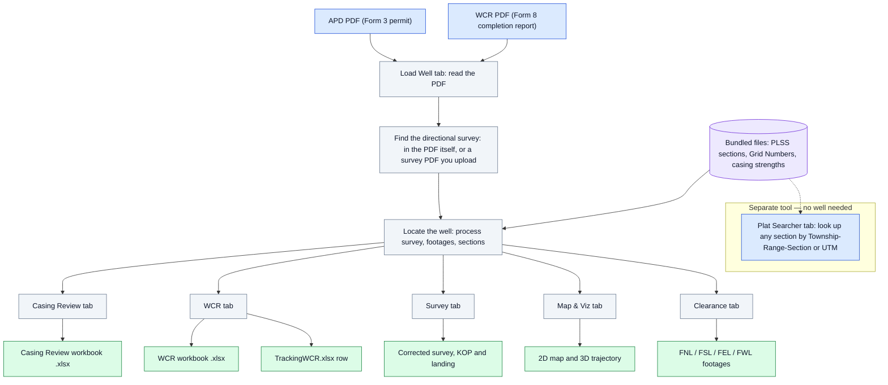
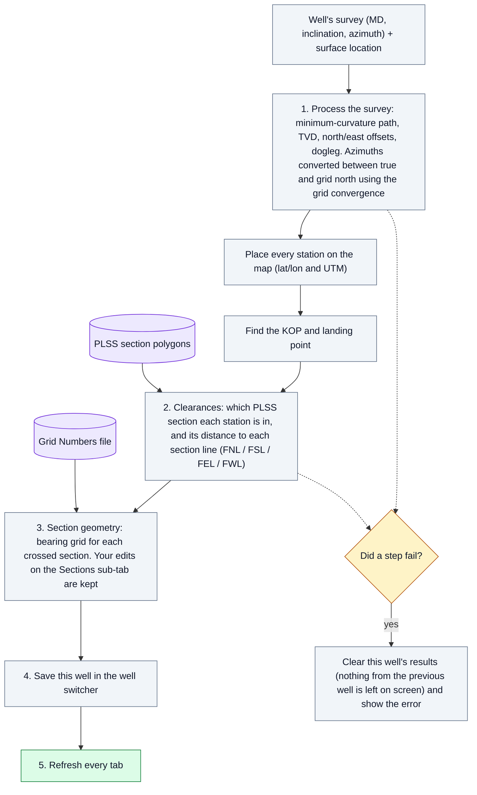
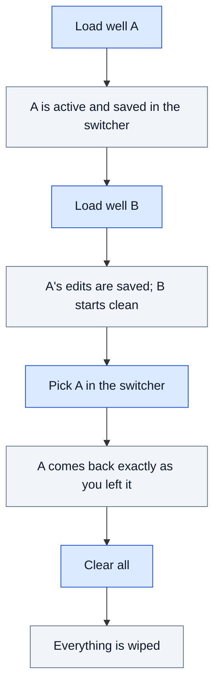
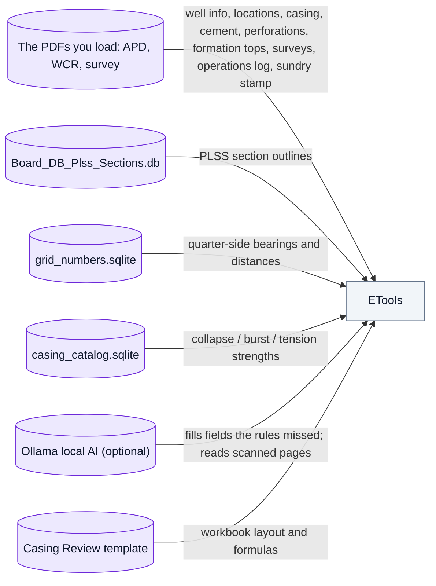

# ETools — How it works

ETools turns the paperwork for a Utah DOGM well into the review workbooks you
submit. You give it a **permit (APD, Form 3)** or a **completion report (WCR,
Form 8)** as a PDF. It reads the PDF, finds the well's directional survey,
works out where the well goes underground, and builds an Excel workbook from
that.

**How to read the charts**

| Shape / colour | Means |
|---|---|
| Blue box | Something you provide (a PDF, a click, a typed value) |
| Grey box | Something ETools does for you automatically |
| Amber diamond | A decision ETools makes ("does the PDF carry a survey table?") |
| Green box | Something you get out (a workbook, a map, a number) |
| Purple box | A data source ETools reads (a bundled file) |

---

## 1. The big picture

There are only **two ways in**: an APD or a WCR. Everything else follows
from the well that PDF describes. ETools has **no database server**: every
well value comes from the PDFs, and the reference data (PLSS sections, Grid
Numbers, casing strengths) is bundled with the app. The **Plat Searcher** is a separate lookup
tool that doesn't need a loaded well.

---

## 2. Starting from a permit (APD) → Casing Review workbook

Use this when you are reviewing a permit to drill.

```mermaid
flowchart TD
    classDef you fill:#dbeafe,stroke:#1d4ed8,color:#0f172a
    classDef auto fill:#f1f5f9,stroke:#64748b,color:#0f172a
    classDef out fill:#dcfce7,stroke:#15803d,color:#0f172a
    classDef dec fill:#fef3c7,stroke:#b45309,color:#0f172a
    classDef data fill:#ede9fe,stroke:#6d28d9,color:#0f172a

    A1["Load Well → From APD PDF: drop the PDF"]:::you
    A2["Pick a parse mode (Rules + LLM is the default) → Parse APD"]:::you
    A3["Read the permit: well name, API, operator, locations, casing table, cement, mud weights, frac gradient, BOPE, formation tops, slant"]:::auto
    A4{"Is this a different well from the one on screen?"}:::dec
    A5["Set the previous well aside in the well switcher; start this one with a clean slate"]:::auto
    A6{"Does the APD carry its directional plan (a survey table)?"}:::dec
    A7["Use the plan as the survey, with the north reference it prints"]:::auto
    A8["No survey yet: TVDs use a straight-line estimate from the permit's MD/TVD. You can upload a survey PDF on the Casing Review tab"]:::auto
    A9{"Can the surface location be placed on the map? (needs a PLSS section or UTM)"}:::dec
    A10["Make it the active well and run the well pipeline (section 4)"]:::auto
    A11["Stay on Casing Review with a 'Use as active well' button"]:::auto
    A12["Casing Review tab opens"]:::auto

    A1 --> A2 --> A3 --> A4
    A4 -- yes --> A5 --> A6
    A4 -- no, same well --> A6
    A6 -- yes --> A7 --> A9
    A6 -- no --> A8 --> A9
    A9 -- yes --> A10 --> A12
    A9 -- no --> A11 --> A12

    A12 --> R1["Review the sub-tabs (table below) and edit anything that's wrong"]:::you
    R1 --> R2["Design factors and diagram recalculate as you type"]:::auto
    R2 --> R3["Generate Excel"]:::you
    R3 --> R4["Copy the Casing Review template and fill in this well's values"]:::auto
    R4 --> R5["Casing Review_API_Well Name.xlsx in the output folder"]:::out
    R5 --> R6["Open in Excel / Open folder / Download"]:::you
```

**Casing Review sub-tabs**

| Sub-tab | What you see | What you can change |
|---|---|---|
| Parsed APD | Everything read from the permit | — |
| Casing inputs | One row per casing string (hole, OD, depth, weight, grade, collar, cement) and the frac gradient | Any value, including mud weight, hole washout % and internal gradient |
| BOPE | Previous shoe depth, BOPE rating, max anticipated pressure | The three hand-entered BOPE inputs |
| Computed design | Collapse, burst and tension loads, design factors, pass/fail against the minimums | — (it follows from the inputs) |
| Sections | One grid per PLSS section the well crosses (SHL section, BHL sections): quarter-side bearings and distances | Any bearing or distance. The map and footages update too |
| WBD | Wellbore diagram: casing, cement, tops | — |
| Formations | Formation tops from the permit | Edit, add or remove tops |
| Output | The last generated workbook | Open in Excel / Open folder / Download |

**What goes in the Casing Review workbook:** Casing Review (strings, loads,
design factors), Formations, DxSurvey (KOP / producing interval / TD path),
Vertical WBD, DataPrint, BOPE, SHL Section and BHL Section 1–3 (bearing grids
and footages), plus the template's reference sheets. Calculated cells are
filled in with numbers, so they show correctly even in viewers that don't
recalculate.

---

## 3. Starting from a completion report (WCR) → WCR workbook

Use this when a well has been drilled and the operator filed Form 8.

```mermaid
flowchart TD
    classDef you fill:#dbeafe,stroke:#1d4ed8,color:#0f172a
    classDef auto fill:#f1f5f9,stroke:#64748b,color:#0f172a
    classDef out fill:#dcfce7,stroke:#15803d,color:#0f172a
    classDef dec fill:#fef3c7,stroke:#b45309,color:#0f172a
    classDef data fill:#ede9fe,stroke:#6d28d9,color:#0f172a

    W1["Load Well → From WCR PDF: drop the PDF"]:::you
    W2["Pick parse mode and scope (first 5 pages is fastest; whole PDF; whole PDF + operations summary is slowest) → Parse WCR"]:::you
    W3["Read the report: well info, depths (TD, PBTD), elevations, surface / producing interval / TD positions, perforation stages, formations"]:::auto
    W4{"Different well from the one on screen?"}:::dec
    W5["Set the previous well aside; start clean"]:::auto
    W6{"Does the WCR carry the as-drilled survey report?"}:::dec
    W7["Use it, with the north reference it prints"]:::auto
    W8["WCR tab asks for a survey PDF"]:::you
    W8b["Read the survey PDF: text first, then OCR, then the vision AI if needed"]:::auto
    W9["Make it the active well if it can be placed; run the well pipeline (section 4)"]:::auto
    W10["WCR tab opens"]:::auto

    W1 --> W2 --> W3 --> W4
    W4 -- yes --> W5 --> W6
    W4 -- no --> W6
    W6 -- yes --> W7 --> W9
    W6 -- no --> W8 --> W8b --> W9
    W9 --> W10

    W10 --> V1["Optional: Open operations log beside the PDF"]:::you
    V1 --> V2["Left: the operations log grouped by day, wording unchanged, tidied layout. Right: the report's own pages"]:::auto
    V2 --> V3["Click a day or an entry: the PDF scrolls there and highlights that row. Type in the filter box to narrow the list"]:::out

    W10 --> G1["Generate WCR Excel"]:::you
    G1 --> G2["Pick the five key depths: SHL, Control Point (KOP), Frac Start (first perf), Frac End (last perf), BHL (TD)"]:::auto
    G2 --> G3{"Where does the KOP come from?"}:::dec
    G3 -- "1st choice" --> K1["The operator's driller note in the report"]:::auto
    G3 -- "2nd choice" --> K2["Where inclination first passes 8°"]:::auto
    G3 -- "last resort" --> K3["Consensus of five survey-shape methods"]:::auto
    K1 --> G4
    K2 --> G4
    K3 --> G4
    G4["For each depth: TVD, easting / northing, PLSS section, footages. Casing table from Sections 28-29, perforation date from Section 35"]:::auto
    G4 --> G5["Well-Name_API_WCR.xlsx in the output folder"]:::out
    G5 --> G6["Optional: edit MD / easting / northing in the rows → Save updated Excel"]:::you
    G5 --> G7["Optional: tick what was checked → Update Personal Record"]:::you
    G7 --> G8["Adds or updates the row in TrackingWCR.xlsx: sundry number from the WCR's page stamp, date filed pre-filled from its RECEIVED stamp (editable)"]:::out
```

The RECEIVED stamp is DOGM's received date, usually a few days after the
operator submitted; correct the date-filed box if you know the submit date.

---

## 4. What happens every time a well becomes active

This runs automatically after an APD or WCR is promoted. It also runs when you
click **Process Survey** or **Calculate Clearances**, edit the survey, or
switch wells. A "Working…" window shows each step.

---

## 5. Tab by tab

| Tab | Needs | What it's for | Buttons and tools |
|---|---|---|---|
| **Load Well** | — | The only way to bring a well in | *From APD PDF* or *From WCR PDF*, a parse mode (Rules only / Rules + LLM / LLM only), then Parse |
| **Casing Review** | A parsed APD | Casing design check → Casing Review workbook | Sub-tabs in section 2, *Use as active well*, *Generate Excel*, optional *Survey PDF* upload |
| **WCR** | A parsed WCR | Completion-report check → WCR workbook | *Generate WCR Excel*, editable location rows + *Save updated Excel*, *Survey PDF* upload when the WCR has no survey, *Open operations log beside the PDF* (in the Operation Summary Reports section: click a day or entry to jump to it in the PDF; filter box), the *Personal Record* checklist, *Date filed* + *Update Personal Record* |
| **Survey** | An active well | See and correct the survey | Citing (Planned / As-Drilled), Frame (True / Grid), *Process Survey*, *Interpolate + Add* (insert a station at an MD), *Delete selected station*, *Reprocess with new SHL*, *Apply convergence*, *Restore original survey*. Every edit re-runs section 4 |
| **Map & Viz** | Clearances | See where the well goes | *2D Map*: sections, well path, 100 / 330 / 500 ft setback buffers, click a station or section for details, basemap choice, *Add point* / *Clear points*. *3D Trajectory*: the wellbore under the crossed sections (outlined at the surface); hover for MD, angles, section and footages |
| **Clearance** | A processed survey | Footage tables | Summary (SHL · KOP · Landing · BHL) and every station's FNL / FSL / FEL / FWL; *Calculate Clearances* re-runs section 4 |
| **Plat Searcher** | Nothing | Look up PLSS sections on their own | *Sections*: search by Section–Township–Range or by UTM. *Adjacency*: neighbouring sections. *Distance Checker*: perpendicular distance from a point to the line A–B (UTM, decimal lat/lon or deg-min-sec) |
| **Help** | Nothing | This page | — |

**Header bar:** the **well switcher** lists every well loaded this session
(tagged APD / WCR / APD+WCR). Pick one to go back to it with your edits
intact, or close it. **Clear all** removes every loaded well and all parsed
data.

---

## 6. Working with several wells

Loading an APD and a WCR for the **same** API keeps both together in one
well (the switcher shows "APD+WCR").

---

## 7. Where files go

| What | Where |
|---|---|
| Casing Review workbooks | `output\Casing Review_<API>_<Well Name>.xlsx` |
| WCR workbooks | `output\<Well Name>_<API>_WCR.xlsx` |
| Personal tracking record | `TrackingWCR.xlsx`, next to the app folder (one shared file, updated in place) |
| Diagnostics log | `output\logs\etools.log`, the file to send if something goes wrong |

In the portable copy, `output` is the folder next to `ETools.bat`.

If Excel has a workbook open, ETools can't overwrite it. You'll be told to
close it and try again, and the previous file is never left half-written.

---

## 8. Where the information comes from

- **A PDF without a survey?** Many WCRs don't attach the survey report.
  You'll see that no survey was found; upload the survey PDF instead.
- **No AI engine?** Pick *Rules only*. Everything except the AI backfill and
  scanned-page reading works.

---

## 9. When something looks wrong

| You see | It usually means | Do this |
|---|---|---|
| "No survey loaded — upload one below" / "No directional survey table found in this APD" | The PDF doesn't carry a survey table | Upload the survey PDF on the WCR or Casing Review tab |
| "APD has no PLSS section we can geolocate" | The surface location couldn't be placed | Load a survey PDF, or set the surface location on the Survey tab |
| A value parsed wrong | The PDF layout confused the reader | Fix it in the tab (Casing inputs, Formations, Sections, WCR rows) before generating |
| "…is open in Excel" | The workbook is locked | Close it in Excel and click again |
| A tab says it failed to load | A bundled data file is missing | See the startup message / log for which file |
| Changes you expected aren't there | The app wasn't restarted after an update, or the workbook wasn't regenerated | Close ETools fully, start it again, and click Generate again |

---

## 10. Words used in the app

| Term | Meaning |
|---|---|
| **APD** | Application for Permit to Drill (DOGM Form 3) |
| **WCR** | Well Completion Report (DOGM Form 8) |
| **API** | The well's 10–14 digit ID number |
| **SHL / BHL** | Surface hole location / bottom hole location |
| **MD / TVD** | Measured depth along the hole / true vertical depth straight down |
| **KOP** | Kick-off point, where the hole starts to curve |
| **Landing** | Where the curve reaches horizontal |
| **Planned / As-Drilled** | The proposed survey / the survey actually drilled (the "citing type") |
| **True / Grid north** | North to the pole / north on the map grid; the difference is the **grid convergence** |
| **PLSS** | Public Land Survey System: Section, Township, Range |
| **FNL / FSL / FEL / FWL** | Distance from the north / south / east / west section line |
| **Quarter-side** | Half of one side of a section, one row of the Grid Numbers bearings |
| **Setback** | Required distance from a section line (100 / 330 / 500 ft on the map) |
| **Frac gradient** | Pressure per foot that would fracture the rock at the casing shoe |
| **BOPE** | Blowout prevention equipment |
| **TOC / TOL** | Top of cement / top of liner |
| **Design factor** | Casing strength ÷ load; must be above the minimum to pass |
| **Parse mode** | *Rules* reads the PDF with fixed patterns (fast); *LLM* asks the local AI; *Rules + LLM* uses rules first and the AI for gaps |
